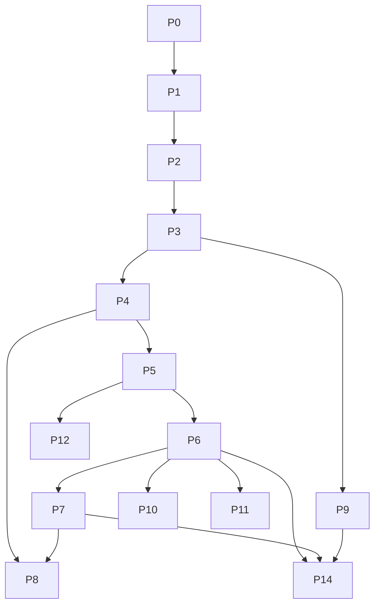

# IMPLEMENTATION PHASES

Companions: [PROJECT_HANDOFF.md](PROJECT_HANDOFF.md) · [TESTING_AND_KNOWN_ISSUES.md](TESTING_AND_KNOWN_ISSUES.md) · [REFERENCES_AND_LITERATURE_REVIEW.md](REFERENCES_AND_LITERATURE_REVIEW.md)
Status labels used everywhere: **Completed and tested · Implemented but not fully tested · Partially implemented · Planned but not started · Blocked · Rejected**.
Chronology evidence: session dates 13–16 Oct 2026 (file timestamps / tool output). No git history exists (folder is not a git repo), so finer dating is *not available*.

## 1. Master roadmap

| # | Phase | Objective | Status | Verification evidence |
|---|---|---|---|---|
| 0 | Baseline setup | one clean SARIMA+LSTM app, env-driven | **Completed and tested** | Flask test-client 200s on all pages |
| 1 | Service split | frontend/API/Postgres, Compose | **Completed and tested** | compose up; register/login/predict/result pages 200; row in Postgres |
| 2 | Kubernetes + observability | Minikube, Prometheus, Grafana | **Completed and tested** (OTel tracing: Planned but not started) | pods Running; Prometheus queries return model_load_seconds, restarts |
| 3 | Fault/load harness + baselines | A/B/C data | **Completed and tested** | `results/fault_trials.jsonl`, `load.jsonl` |
| 4 | Guard, canary, tiers (N1,N2), config D | silent-fault handling | **Completed and tested** (D data valid after re-run) | 5 trials/fault; corrupt recovered 3.5 s |
| 5 | Soft invariants (C2) + window calibration | extra semantic checks | **Partially implemented** (offline evidence only) | `results/phase5_guard_ablation.json` |
| 6 | Silent-fault benchmark (C3) | taxonomy + correctness metric | **Completed and tested (10 trials per cell + 10-min healthy soak)** | `results/silentbench.jsonl`, validation 15/15 |
| 7 | Correctness SLO (C1) | SLI/burn-rate | **Measured (small sample, see TESTING 3.7)** | `/slo`, `served_valid/invalid`, `monitoring/slo-values.yaml`, `analysis/slo_replay.py` |
| 8 | Operator + recovery policy (N3) | automatic tier restore | **Measured (see TESTING 3.8, 3.9)** | `operator/*`, `chaos/run_operator.py` |
| 9 | DoE/RSM + Bayesian probes (N4) | tuned probes | **DoE executed (30 runs); bounded BO recommendation validated on held-out runs (see TESTING 3.10)** | `chaos/doe.py`, `bo_probe.py` compile; BO smoke-tested on synthetic data (output deleted) |
| 10 | Failure predictor | Isolation Forest on telemetry (leak, drift) | **Measured (see TESTING 3.11)** | `analysis/failure_predictor.py`, `results/predictor_results.json` |
| 11 | Delivery/security (N5) | shadow gate, Argo, Kyverno, CI | **Shadow gate measured in cluster (TESTING 3.12); Argo/Kyverno/CI not run (extras)** | `analysis/shadow_gate_cluster.py` |
| 12 | Additions A1–A3 | aging, drift-retrain, energy | **Measured in cluster (TESTING 3.13)** | `analysis/phase12_cluster.py`, `results/phase12.json` |
| 13 | Secondary experiments | adaptive conformal, KEDA, SARIMA vs LSTM | **Adaptive conformal + model family measured (TESTING 3.14, 3.15); KEDA not run (extras)** | `analysis/adaptive_conformal.py`, `chaos/run_family.py` |
| 14 | Results + paper | figures, stats, write-up | Planned but not started | survey PDF only |

## 2. Per-phase detail

### Phase 0 — Baseline setup
- **Entry:** two source folders: original SARIMA app (`bangalore_climate_app`, dated 16 Jun) and LSTM zip (older, 8–14 May).
- **Design:** build `monolith/` from the *newer* SARIMA code; copy LSTM-only parts (`utils/lstm_model.py`, `lstm_numpy.py`, `train_lstm.py`, `lstm_predict.html`, `lstm_result.html`, 2 routes, nav link, `saved_models/lstm`). Initial mistake (using LSTM zip files as base) was caught by diffing (`app.py` 843 differing lines) and corrected.
- **Changes:** `app.secret_key = os.environ['SECRET_KEY']`; `DB_PATH`, `MODEL_DIR`, `HOST`, `PORT`, `FLASK_DEBUG` env vars; `init_db()` at import (gunicorn needs it); `_MODELS` cache + `RELOAD_MODELS_EACH_REQUEST=1` switch; `forecast_lstm_simple` now calls `utils.lstm_model.forecast_lstm` with cached `.h5` models, seasonal repeat only as fallback.
- **Dependencies fixed:** `Werkzeug==2.3.6` conflicted with Flask 2.3.3 → 2.3.7; `seaborn` missing; `tensorflow-cpu==2.15.1` added.
- **Test:** all routes 200 via Flask test client with a temp SQLite DB; real LSTM forecasts printed (rainfall 87.3/125.4/168.1).
- **Known effect:** LSTM page numbers differ from the original stand-in.

### Phase 1 — Service split
- **Files:** `inference-api/{app,backends,metrics}.py`; `frontend/app.py` (+`_RemoteSarimaVar`, `remote_forecast`, `/metrics`, `/healthz`), `utils/database.py` dual SQLite/PostgreSQL with `pg_advisory_xact_lock`; `docker-compose.yml`.
- **Bugs found and fixed:** missing `matplotlib/seaborn` in inference image (worker failed to boot); two gunicorn workers raced on `CREATE TABLE` (UniqueViolation) → advisory lock; frontend crash-looped before Postgres ready → K8s init container.
- **Test:** compose up; register, login, dashboard/history/analysis/result/lstm_result 200; Postgres row count 1; `/metrics` shows sarima and lstm requests.
- **Observed:** first LSTM request ≈ 3.3 s vs ≈ 0.7 s later (TF warm-up).

### Phase 2 — Kubernetes and observability
- **Files:** `k8s/00-base.yaml`, `10-inference.yaml`, `20-frontend.yaml`; `monitoring/dashboard.json` (12 panels, 5 s refresh), `grafana-values.yaml`.
- **Commands (see `k8s/README.md`):** `minikube start --driver=docker --cpus=4 --memory=5500`; `minikube image load`; `kubectl apply -f k8s/`; helm `prometheus` (scrape 5 s, timeout 4 s) + `grafana`.
- **Bug/fix:** Prometheus crash (scrape_timeout 10 s > interval 5 s) → set 4 s.
- **Evidence:** model load SARIMA ≈ 1.3–1.6 s/var, LSTM 1.9–10.8 s; memory inference ≈ 800 MiB, frontend ≈ 216 MiB.

### Phase 3 — Harness and baselines
- **Files:** `chaos/probe.py` (fault, load modes), `chaos/run.py`, results JSONL.
- **Method:** probe runs inside the compose network / a K8s pod (single clock). Fault trial: 10 req/s, inject after 15 s, recovery = 10 consecutive good responses (`good()` also requires finite values for `/predict`). Faults: crash (SIGQUIT parent), hang (sleep), oom (allocate), corrupt (NaN output).
- **Failures of the run itself (root causes):** (1) batch died when Docker Desktop stopped (laptop sleep/sign-out) — fixed by keep-awake + restart; (2) detached PowerShell quoting failure — fixed by `.ps1` files; (3) config D first run invalid (image `:3` never built, silent build failure) — see Phase 4.
- **Evidence:** see `TESTING_AND_KNOWN_ISSUES.md` §3 tables.

### Phase 4 — Guard, canary, tiers
- **Files:** `inference-api/guard.py`, `app.py`.
- **Design iterations (documented):**
  1. v1: per-request evaluation of all models + vote → single worker saturated (LSTM 3–4 s/request via `model.predict`), liveness timeouts, pod SIGTERM loop.
  2. v2 (final): per request only chosen tier + cheap envelope (0.08 ms); vote in background canary (5 s); LSTM step compiled with `tf.function` (4.2 s → 0.15 s, identical outputs).
- **Config D result:** corrupt → recovered 3.5 s median, served `climatology` (degraded); crash/hang/oom not improved.
- **Limitation:** remains degraded until restart (operator not run).

### Phase 5 — Invariants and window calibration
- **Files:** `analysis/mine_invariants.py`, `analysis/guard_ablation.py`, `guard.py` (`load_invariants`, `invariant_score`, `calibrate_windows`, `score`), `invariants.json`.
- **What happened:** (a) per-value α = 0.01 gave ≈ 24 % window-level false alarms on healthy 6-month history windows → switched to **window-maximum calibration**; (b) cross-variable relations failed hold-out (0.82–0.94) → tried trend term (worse, rejected), short windows (worse), pooled conformal scores (hold-rates 0.93–1.0 but acceptance band > 1 std for most) → kept only relations passing pre-set rules (hold ≥ 0.95, band ≤ 1 std): `dt_Temp_mean` and flatline.
- **Ablation (hold-out windows after 2018, L = 6, α = 0.01):** false alarm 0 %; detection unit change 100 %, scaler 100 %, variable swap 100 %, NaN 100 %, hum −20 % 80 %, rain ×3 73 %, temp +4 °C 32 %, flatline 37 % → 100 % with invariants. α = 0.05: false alarm 20 % (envelope) / 36.7 % (+inv).
- **Open:** humidity PSI (3.07) cause unverified; correlations stable across periods (R–H ≈ 0.6) so not a simple break.

### Phase 6 — Silent-fault benchmark (current)
- **Done:** injectors in `inference-api/app.py` (`_apply_output_fault`, `_inject_weights`, `_heal_all`): `corrupt`, `bitflip` (8 exponent-MSB flips in first LSTM kernel, real weights), `bitflip_severe` (16), `scaler` (scaler.scale_ ×0.35), `stale` (roll by len/2), `unitchange` (°C→°F), `flatline`, `delay` (30 % requests +1.5 s); `heal` restores weights/scalers; `/fault?mode=status`.
- **Bugs found by local test and fixed:** `stale` rolled by 6 on 6 steps (no-op) → roll by len//2; `bitflip` with bit 27/28 and 4–16 flips produced <5 % change (masked) → exponent MSB (bit 30) gives plausible-but-wrong output (N=8 in-envelope, N=16 detectable).
- **Probe:** `chaos/probe.py::silent_trial` classifies each response as correct / wrong / fallback / degraded / failed against a golden baseline (tolerances Rain 25 mm+10 %, Temp 1.5 °C+5 %, Hum 6 %+5 %); reports detect time, p95, recovery after heal.
- **Runner:** `run.py --silent --configs C4 D4 E4` (image `:4`; guard off / envelope / envelope+inv; verified image+env before measuring).
- **Pilot (done):** C4,E4 × corrupt, unitchange, bitflip × 1 trial. Findings: C4 100 % wrong for all three; E4 corrupt → 100 % degraded (valid); E4 unitchange → 46.7 % failed (timeouts); E4 bitflip → 100 % wrong (undetected). Defects fixed at root cause: runner config routing (K19), no memory of rejected tiers + canary ignoring `score>1` (K18), negative detect time (K20).
- **Full run (running, started 2026-10-16 02:41):** `chaos/auto_phase56.ps1` → pass 1 (5 trials × 8 faults × C4/D4/E4), healthy soak 10 min × 3, DoE on C4 (hang, CCD, 2 repeats), `bo_probe.py`, pass 2 (trial offset 5), summary + PDF. Log: `results/phase56_auto.log`; done flag `results/phase56_done.flag`.
- **Acceptance for completion:** ≥ 10 trials per cell for 8 faults × 3 configs; `silentbench_summary.csv` produced; live healthy soak (false-alarm) recorded.

### Phase 7 — Correctness SLO (not started)
Tasks: `semantic_pass/fail` counters; binomial lower bound; burn-rate rules on correctness; exchangeability gauge; dashboard panels; replay benchmark faults; operator hook. Prereq: Phase 6 data.

### Phases 8–14
As in the roadmap; code exists for 8, 9, 11, 12 (see PROJECT_HANDOFF §5). None has been run on the cluster except where stated.

### Validation suite (covers everything through Phase 6)
`validation/validate_all.py` — 15 executed checks: docker/kubectl, pods Running, images in minikube, compile of all Python, unit tests, data/model files, in-process service in baseline mode and with guard (faults corrupt/unitchange/flatline/scaler detected, heal restores output), reproducibility of the guard ablation, cluster `/health/ready` + `/health/semantic`, cluster fault cycle, frontend flows + PostgreSQL persistence, Prometheus + Grafana, integrity of baseline and silent-benchmark result files. Output: `results/validation_report.md` (PASS / FAIL / SKIP with evidence).

### Phase 7 and 8 implementation (written 2026-10-16, runs after pass 2)
- **Phase 7:** `inference-api/app.py` records, for every served response, an independent post-hoc validity check (`served_valid_total` / `served_invalid_total{tier}`), degraded share, `/slo` (served, invalid, degraded, one-sided 95 % Wilson lower bound, quality SLI) and an output-score shift gauge (`output_score_shift_ks`: KS vs the first 100 served scores). `monitoring/slo-values.yaml`: SLO 99 %, windows 30 s/2 m (demo) and 5 m/1 h, 30 m/6 h (production style), Wilson-lower recording rule, alerts CorrectnessFastBurnDemo / FastBurn / SlowBurn, DegradedServing, OutputScoreShift. `analysis/slo_replay.py` injects each fault under 5 rps load and records time to the correctness alert and to the degraded alert (via Prometheus) for C4 vs E4.
- **Phase 8:** operator action mapping (tier_switch -> none; restart_only / switch_then_restart -> restart), policy ConfigMap mounted at /policy, `chaos/run_operator.py` (policies none / rules / bandit x faults corrupt, unitchange, scaler, flatline x 5; `--no-heal`; metric `restored_s`), `analysis/twin_bandit.py` extended with a third action `switch_then_restart`.
- **Run order:** `chaos/after_partB.ps1` -> `chaos/phase78.ps1` (build `climate-inference:5` and `climate-operator:2`, load, deploy operator, apply rules, replay, operator experiments, re-run twin). Outputs: `results/slo_replay.jsonl`, `results/operator_trials.jsonl`, `results/phase78.log`, `results/phase78_done.flag`.

### Phase 7/8 restart (2026-10-16 09:01)
First Phase 7/8 run (image :5) was stopped and its rows moved to `*_invalid_*` files after two root causes were found: K25 (liveness timeouts, pod restarts) and K26 (stale recording-rule timings). Re-run via `chaos/phase78b.ps1` on image `climate-inference:6` (gthread, 4 threads), Prometheus `evaluation_interval` 5 s, direct burn-rate queries in `analysis/slo_replay.py`. Log: `results/phase78.log`.

### Stopping point (2026-10-16, about 10:15)
User closed the laptop. Completed: Phases 0-7 (7 with a small sample). Not run: Phase 8 operator experiments, twin re-run with the third action, Phases 10-14 remainder. Automation stopped; cluster left running only as long as Docker stays up.
**Resume on the new machine:** follow RESTORE.md, then `set INFER_TAG=6`, `python chaos/run_operator.py --trials 5`, `python analysis/twin_bandit.py`, `python analysis/slo_replay.py --configs E4 --trials 3`, then Phase 9 re-analysis (K23), Phase 11-14.

### Phase 9 and 10 plan (queued 2026-10-16; starts automatically after Phase 8)
- **Phase 9 (validate tuned probes):** `chaos/validate_probe.py` runs the hang fault on three settings - default 10/3/1, bounded-BO recommended (from `analysis/bo_result.json`), observed DoE best - 5 trials each on config C4 (image :4); Mann-Whitney test of recovery vs default. Output `results/probe_validation.jsonl`.
- **Phase 10 (failure predictor):** new precursor faults in `inference-api/app.py` (`leak`: about 25 MB/s until OOM kill; `drift`: temperature scaler decays over 90 s), `process_rss_bytes` metric, image :7. `analysis/collect_telemetry.py` scrapes `/metrics` every 2 s under 5 rps (2 healthy recordings, 6 leak, 6 drift); `analysis/failure_predictor.py` trains Isolation Forest and a Mahalanobis detector on healthy data only, calibrates thresholds on a held-out healthy part, compares lead time against a static 80 % memory threshold and the reactive guard. Isolation Forest cannot extrapolate beyond its training range (found with a synthetic test), hence the second detector; report both.
- **Orchestration:** `chaos/phase910.ps1` (waits for `results/phase8_done.flag`) -> `results/phase910.log`, `results/phase910_done.flag`; `analysis/summarize_phase9_10.py` writes TESTING 3.10 and 3.11 and the PDF is rebuilt.

## 3. Chronological change log (sequence from the sessions)
1. Survey/analysis of original app; duplicate data/models identified (md5 equal for 3 data copies; 118 MB models ×3).
2. Merge into `devops_project/monolith`; env config; LSTM wiring.
3. Services, Compose, PostgreSQL, K8s, Prometheus/Grafana.
4. Fault/load harness; baseline batches (interrupted twice by Docker stopping; re-run).
5. Guard v1 → crash-loop → guard v2 + LSTM speed-up; config D re-run.
6. Aging, drift, retrain loop, energy-aware tiers (local tests).
7. Operator, DoE, BO, shadow gate, CI/policy manifests (code only).
8. Window-level calibration + invariants + ablation.
9. Benchmark injectors/probe/runner; pilot.

## 4. Dependency map

Critical path: P3 → P4 → P5 → P6 → P7 → P14. Parallel: P9 (cluster time only), P11, P12. High risk: sleep/Docker stop, image build verification.

## 5. Decisions and alternatives
| Decision | Why | Alternative | Note |
|---|---|---|---|
| Base on newer SARIMA code | LSTM zip older | use LSTM zip as base | verified by diff |
| Window-level conformal calibration | per-value α inflates window FA | Bonferroni | measured FA 0 % hold-out |
| Canary vote in background | per-request vote saturates worker | per-request | observed crash loop |
| Pooled conformal quantile for invariants | per-month n≈7 unreliable | per-month q | hold-rate improved |
| Heal endpoint instead of pod restart between silent trials | speed | restart | weights/scaler restored in memory |
| Probe at `model=auto&steps=6` | exercises LSTM first + flatline check (n ≥ 4) | steps=3 | flatline needs ≥ 4 steps |

## 6. Current phase and next steps
Current: **Phase 6**, full run executing (`auto_phase56.ps1`). Next: when `results/phase56_done.flag` = done: read `results/silentbench_summary.md`, `results/doe.jsonl`, `analysis/bo_result.json`; check that D4/E4 rows show the K18 fix (failed % low for unitchange); then Phase 7.
Acceptance for Phase 6: see §2. Required tests: injector unit/local test (done), pilot (running), full run (not run).

## 7. Remaining roadmap (condensed)
7 Correctness SLO → 8 Operator on cluster → 9 DoE + BO → 11 Argo/Kyverno/CI (needs GitHub repo) → 12 in-cluster A1–A3 → 13 adaptive conformal evaluation, KEDA → 14 figures/stats/paper. Definition of done per phase = its "Acceptance" line plus results saved under `results/` and referenced in the paper tables.

## 8. Readiness checklist (evidence-based)
- [x] Platform runs (A/B/C/D) — evidence: results files.
- [x] Dependencies pinned in requirements files (note: host versions differ).
- [ ] All requirements implemented — C1, N3 (deployed), N4 (data), N5 (cluster) missing.
- [ ] Tests pass — only 2 unit tests exist; benchmark not run.
- [ ] Security reviewed — not done (default secrets, no CSRF audit).
- [ ] Research claims supported — wider literature search NOT done.
- [ ] Documentation complete — this package + survey; paper not written.

## 9. Resume prompt (paste into a new chat)
"Continue the DevOps project at `C:\Users\manas\OneDrive\Desktop\bangalore_climate_app_final\devops_project`. First read PROJECT_HANDOFF.md, IMPLEMENTATION_PHASES.md, TESTING_AND_KNOWN_ISSUES.md and REFERENCES_AND_LITERATURE_REVIEW.md. Current phase: Phase 6 (silent-fault benchmark). Check `results/pilot_silent.log` and `results/silentbench*.jsonl`, fix any root cause found, then run the full benchmark (`python chaos/run.py --silent --configs C4 D4 E4 --trials 5`, then `--trial-offset 5`), summarise with `analysis/silentbench_summary.py`, then implement Phase 7 (correctness SLO). Verify every image build and pod image before measuring. Keep token use low; do not claim novelty beyond the evidence."

## 10. ADDENDUM (updated 2026-10-17): phases 7-13 as implemented, and the extras

### Phase 7 - correctness SLO (done, small sample)
Service: `served_valid/invalid_total`, `/slo` (Wilson lower bound), `output_score_shift_ks`; rules `monitoring/slo-values.yaml`; replay `analysis/slo_replay.py` on image :6 (C4 3 trials, E4 2 trials per fault). Root causes fixed: stale recording rules (evaluation interval 1 m -> direct queries, 5 s) and pod restarts from a saturated sync worker (gthread, 4 threads). Results: TESTING 3.7.
### Phase 8 - operator (done)
`operator/forecast_operator.py`, CRD/RBAC, policy ConfigMap; `chaos/run_operator.py` (none / rules / bandit x corrupt, unitchange, scaler, flatline x 5). Rules: 20/20 restored in 20-26 s median; bandit restored only scaler; none never. Twin re-run with `switch_then_restart`. Kopf logs a namespace-permission warning (K27). TESTING 3.8, 3.9.
### Phase 9 - probe tuning validation (done)
`chaos/validate_probe.py` + `_control.py`; recommended 7/5/3 and controls. Replicas explain the gain (K28). TESTING 3.10.
### Phase 10 - failure predictor (done)
Leak and drift precursor faults, telemetry collector, Isolation Forest + Mahalanobis vs static threshold and reactive guard; failure marker fixed (K29). TESTING 3.11.
### Phase 11 - shadow gate in the cluster (done)
`/shadow/*` endpoints, 8 candidate sets (`analysis/make_candidates.py`), `analysis/shadow_gate_cluster.py`: 15/15 bad rejected, 6/6 good promoted; final re-check 5/5 and 2/2. Fixes: UTF-8 mode for training prints, relative path for `kubectl cp` on Windows. TESTING 3.12. Argo/Kyverno/CI not run.
### Phase 12 - aging, drift, energy, retraining in the cluster (done)
`analysis/phase12_cluster.py`: /aging, /drift, energy-aware vs always-LSTM (0.93 vs 3.99 J/request), retrain-vs-production RMSE. TESTING 3.13, K33, K34.
### Phase 13 - secondary experiments (done)
Adaptive conformal study (offline), SARIMA vs LSTM vs both under crash/oom/hang (`chaos/run_family.py`). KEDA not run. TESTING 3.14, 3.15, K32.
### Extras (see EXTRAS_AND_FUTURE_WORK.md for the per-item status)
Offline batch 1 and predictor extras (TESTING 3.16); cluster extras e1-e8, scaling, Chronos attempt (TESTING 3.17, filled in when the batch finishes); `results/incident_reports.md`; `release/silentbench_release.zip`.

### Chronological log (continued)
- 2026-10-14/15: baseline batches interrupted twice by Docker stopping; config D invalid run (image never built) repaired; guard v2 + LSTM speed-up.
- 2026-10-16: Phase 5/6 (windows calibration, invariants, benchmark pass 1/2, validation 15/15), Phases 7-10 (SLO, operator, probes, predictor), Phases 11-13, final verification (browser + suite 16/16), documents, first push (`0e305ce`).
- 2026-10-17: cluster extras batch (e1-e8), scaling and Chronos run; two test-artefact problems found and fixed (guard left off by the MTTR experiment; timing after heal; K38) and the scaling burst made heavy enough (K37); suite 17/17; documents refreshed; second commit pushed.

### Final implementation readiness checklist (evidence-based, 2026-10-17)
- [x] All main phases 0-13 implemented and measured (TESTING 3.x).
- [x] Application runs end to end in the browser (TESTING 3.0).
- [x] Tests: validation suite 16/16 PASS; unit tests 2 (small).
- [x] Environment reproducible: RESTORE.md, requirements, images tagged, repository pushed.
- [x] Extras: run or explicitly blocked/skipped (see EXTRAS_AND_FUTURE_WORK.md).
- [x] Security review written (SECURITY_REVIEW.md); findings not all remediated.
- [ ] Research claims fully supported: wider literature search not done.
- [ ] Larger samples (10+ trials everywhere), confidence intervals and significance tests: pending in the final phase.
- [ ] Paper written: pending.

## 11. Addendum 2026-10-17: fix round
Golden-output check (G4) fixes K40; cost-aware bandit fixes K41 (20/20 restored); Argo Rollouts run (good promoted, bad aborted); dashboards 13-14; validation 18/18. See TESTING 3.18.

## 12. Phase 14 (done 2026-10-17)
Final statistics (bootstrap CIs, Fisher/Mann-Whitney) and paper figures from raw results: `analysis/phase14_stats.py` -> `results/phase14_tables.md`, `results/phase14_stats.json`, `results/figures/`. Also run: Kyverno+cosign, OpenTelemetry/Jaeger, KEDA, Chaos Mesh, log anomaly, RL autoscaler (TESTING 3.19). Remaining: write the paper, run CI on GitHub, multi-node scaling study.

## 13. Novelty 6 (2026-10-17)
Deadline- and load-aware degradation implemented, measured and regression-tested (TESTING 3.20); K37 root cause corrected (thread pool).

## 14. Metamorphic probe and prior-art check (2026-10-17)
Metamorphic readiness probe built, calibrated and tested (TESTING 3.21; experimental, partly negative). Prior-art search done; novelty reframed as gap-based and empirical (NOVELTY_AND_PRIOR_ART.md).
